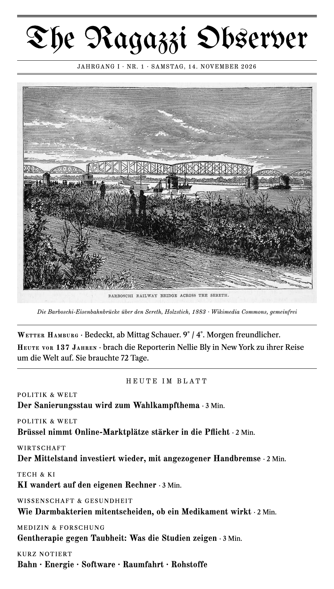
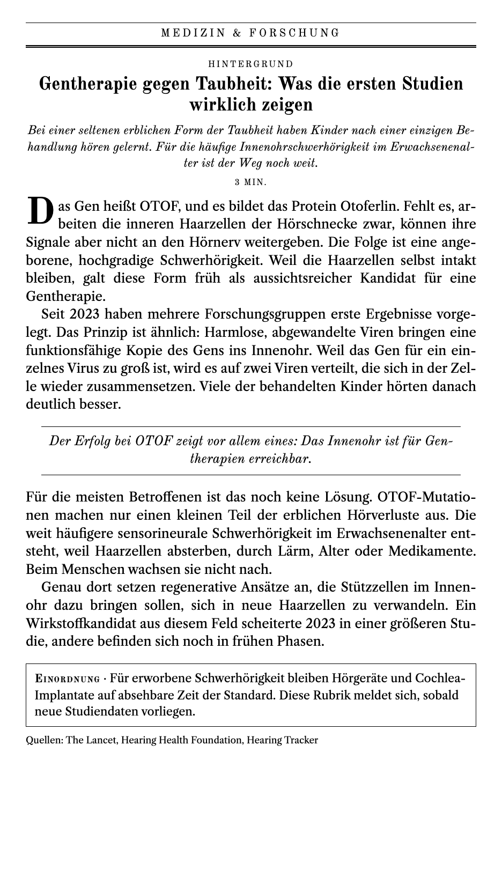

# epub-gazette

**Turn a JSON newspaper issue into a beautifully typeset, Kindle-ready EPUB.**

epub-gazette is a small, stateless rendering service. You hand it the
articles of today's edition as JSON, and it returns an EPUB 3 book that reads
like a printed newspaper from 1900, with a Fraktur masthead, double rules,
drop caps, pull quotes and a front-page engraving, while still reflowing like
any e-book on a Kindle, Kobo or phone.

It is built to sit behind an automation tool such as [n8n](https://n8n.io):
your workflow collects and writes the news (with RSS, an LLM, whatever you
like), epub-gazette does the typesetting, and Send-to-Kindle delivers it.

<p align="center">
  
  &nbsp;
  
  &nbsp;
  
</p>

## Features

- **Real EPUB 3** with an EPUB 2 NCX for older Kindles, uncompressed
  `mimetype`, a cover image recognized by the Kindle library and a nested table
  of contents (sections → articles). Validated with W3C epubcheck in CI.
- **Typography that survives the reader's settings.** The masthead and the
  cover are rendered to images with the theme's own fonts, so the Fraktur never
  falls back to Bookerly. Body fonts are embedded (choose *Publisher Font* on
  the Kindle).
- **E-ink aware.** Illustrations are converted to grayscale, contrast-stretched
  and resized. The CSS avoids features Kindle conversion does not support and
  never sets colors, so dark mode works.
- **Daily cover** showing the name, the date line, the front image and the top
  headlines, so every issue is recognizable in the library.
- **Safe with LLM output.** All text is plain text and escaped; control
  characters are stripped; the input is validated and every problem is
  reported at once.
- **One small binary**: CLI and HTTP server, themes and fonts compiled in,
  distroless container image (< 50 MB, ~10 MB RAM), deterministic output.

## Quick start

```sh
docker run --rm -p 8080:8080 ghcr.io/huulanka/epub-gazette:latest

curl -X POST http://localhost:8080/v1/render \
  -H 'Content-Type: application/json' \
  --data @examples/sample-issue.json \
  -o issue.epub
```

Or with the CLI:

```sh
cargo install --git https://github.com/huulanka/epub-gazette
epub-gazette render examples/sample-issue.json -o issue.epub --cover cover.jpg
```

## The issue format

A minimal issue:

```json
{
  "title": "The Ragazzi Observer",
  "date": "2026-11-14",
  "number": 1,
  "sections": [
    {
      "id": "politik",
      "title": "Politik & Welt",
      "articles": [
        {
          "headline": "Der Sanierungsstau wird zum Wahlkampfthema",
          "dek": "Städte und Gemeinden fordern einen verlässlichen Investitionsfonds.",
          "minutes": 3,
          "paragraphs": ["Erster Absatz …", "Zweiter Absatz …"],
          "pull_quote": "»Wir brauchen Verlässlichkeit.«",
          "context": "Konkrete Beschlüsse sind vor dem Frühjahr nicht zu erwarten.",
          "sources": [{ "name": "tagesschau.de", "url": "https://www.tagesschau.de/…" }]
        }
      ]
    }
  ]
}
```

Optional parts: `volume`, `motto`, `front_image` (base64 + caption + credit),
`weather`, `almanac`, `briefs` (short news) and `colophon`. See
[`examples/sample-issue.json`](examples/sample-issue.json) for a complete issue
and [`schema/issue.v1.json`](schema/issue.v1.json) for the JSON Schema (also
served at `GET /v1/schema`).

Labels and dates are localized for `de` (default) and `en`.

## HTTP API

| Method | Path         | Body       | Response                       |
|--------|--------------|------------|--------------------------------|
| POST   | `/v1/render` | issue JSON | `application/epub+zip`         |
| POST   | `/v1/cover`  | issue JSON | `image/jpeg` (cover preview)   |
| GET    | `/v1/schema` |            | JSON Schema                    |
| GET    | `/v1/themes` |            | available themes               |
| GET    | `/healthz`   |            | `ok`                           |

Errors are JSON, with every validation problem listed:

```json
{ "error": "the issue is invalid", "details": ["sections[0] has no articles"] }
```

Configuration (environment variables):

| Variable       | Default        | Meaning                                                     |
|----------------|----------------|-------------------------------------------------------------|
| `BIND`         | `0.0.0.0:8080` | listen address                                              |
| `RENDER_TOKEN` | –              | if set, `/v1/*` requires `Authorization: Bearer <token>`    |
| `RUST_LOG`     | `info`         | log filter                                                  |

The service keeps no state and needs no volume. Run it on an internal network
next to your automation tool; see [`compose.example.yml`](compose.example.yml).

## Themes

| Id               | Look                                                                    |
|------------------|-------------------------------------------------------------------------|
| `klassisch-1900` | Fraktur masthead, Old Standard headlines, Libre Caslon text, double rules |

A theme is a folder under [`themes/`](themes/) with a stylesheet, minijinja
templates for the XHTML pages and SVG templates for masthead and cover. See
[CONTRIBUTING.md](CONTRIBUTING.md#adding-a-theme).

## Documentation

- [Kindle notes](docs/kindle-notes.md): Send-to-Kindle, publisher font, what Kindle CSS can and cannot do
- [n8n integration](docs/n8n-integration.md): calling the renderer from a workflow
- [Architecture decisions](docs/adr/)

## Development

```sh
cargo test                     # unit, integration, HTTP and snapshot tests
UPDATE_SCHEMA=1 cargo test     # regenerate schema/issue.v1.json
cargo insta review             # review changed markup snapshots
cargo run -- serve             # local server on :8080
```

CI runs `cargo fmt`, `clippy -D warnings`, the tests, W3C epubcheck on the
sample issue and a Docker build. Tags `vX.Y.Z` publish multi-arch images to
GHCR.

## License

Code: [MIT](LICENSE-MIT) or [Apache-2.0](LICENSE-APACHE), at your option.
Fonts: SIL Open Font License 1.1 (see `themes/*/fonts/licenses`). See
[CREDITS.md](CREDITS.md).
